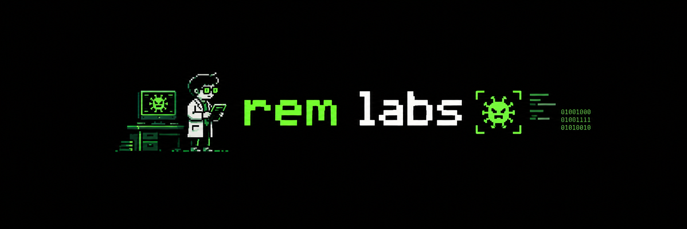

<div align="center">

  

  <h1>rem labs</h1>
  <p><strong>A reproducible notebook of malware reverse-engineering labs.</strong></p>

  <p>
    
    
    
    
  </p>
</div>

> [!CAUTION]
> **Potentially live malware samples. Treat all samples, dumps, and extracted artifacts as malicious unless proven otherwise.**
>
> Do not execute samples on your host machine, your daily-use workstation, or a network connected to sensitive systems. Use a purpose-built, isolated analysis environment with controlled networking and snapshots. Never upload samples to public services unless you are authorized to do so and understand the disclosure implications.

---

## About

`rem labs` is my personal collection of hands-on labs focused on **malware reverse engineering and low-level program analysis**.

Each lab documents an investigation of a sample or technique, with an emphasis on evidence and reproducibility: what I observed, how I tested my hypotheses, which tools I used, and how another researcher can repeat the analysis safely.

Topics may include:

- Static and dynamic analysis
- x86/x64 assembly and debugging
- PE files and Windows internals
- Anti-debugging and anti-analysis techniques
- Obfuscation, decoding loops, and runtime memory changes
- Strings, imports, control flow, and stack inspection
- Indicators of compromise (IOCs), where relevant
- Lab setup, tooling, and reproducible observations

This repository is a **research notebook**, not a collection of instructions to deploy malware. Analysis is performed for education, defensive research, and understanding program behavior.

## Lab status

| Label | Meaning |
|---|---|
|  | The investigation or write-up is still being developed. |
|  | The documented steps and conclusions have been reviewed. |
|  | Findings, reproduction steps, or references need another pass. |
|  | Kept for reference; no longer actively maintained. |
|  | The lab may involve a real, functional malware sample. Handle accordingly. |

## Repository structure

```text
rem-labs/
├── README.md
├── labs/
│   ├── 001-pe32-debugging/
│   │   ├── README.md
│   │   ├── notes/
│   │   ├── screenshots/
│   │   └── references.md
│   └── ...
├── remlabsMalware.png 
└── LICENSE
```

The structure may evolve as more labs are added. Sample binaries are **not included by default**; a lab should explain how the sample was obtained legally, or use a safe synthetic sample when possible.

## Labs

| Lab | Focus | Status | Sample handling |
|---|---|---|---|
| [001 — PE32 Debugging & Runtime Obfuscation](labs/001-pe32-debugging/) | PEB checks, timing checks, XOR transformations, x86 control flow, memory inspection |  | Treat as potentially live; see the lab's safety notes |
| More labs coming soon | Additional samples and techniques |  | Per-lab assessment required |

> Lab titles and statuses should reflect the contents actually present in the repository. Update this table as investigations are added or completed.

## Reproducing a lab

Every lab should provide enough context for another researcher to reproduce the **documented observations** without guessing.

1. **Read the safety notes first.** Check the sample type, hash, source, and handling requirements.
2. **Prepare an isolated environment.** Use a dedicated VM or sandbox, take a clean snapshot, and disable shared folders, clipboard integration, and host integrations where appropriate.
3. **Review network access.** Prefer a host-only or otherwise isolated network. Disable networking unless the experiment specifically requires it; if required, use a controlled simulation such as a local service emulator.
4. **Install the documented tools.** Record versions and relevant configuration.
5. **Verify sample identity.** Compare the sample's cryptographic hashes with those listed in the lab.
6. **Follow the steps in order.** Screenshots, addresses, register values, and outputs should be treated as observations from a specific environment; they may differ between runs.
7. **Restore the snapshot.** Revert the VM after analysis and safely dispose of temporary artifacts according to your lab procedures.

A reproduction may differ because of operating-system versions, debugger settings, timing, ASLR, compiler differences, or changes in the sample. Record those differences rather than silently assuming the results are identical.

## Sample safety and handling

- Assume unknown binaries are malicious until assessed.
- Do not run samples directly on your host operating system.
- Do not use a bridged network for a live-malware lab.
- Do not expose credentials, personal files, SSH keys, tokens, or shared folders to the analysis VM.
- Keep snapshots and disposable analysis environments.
- Calculate and document hashes before and after handling.
- Do not commit live samples, password-protected archives containing them, extracted payloads, or other dangerous artifacts without a clear legal basis and a deliberate distribution plan.
- Prefer hashes, metadata, screenshots, sanitized logs, and synthetic examples when those are sufficient for reproducibility.
- Treat PCAPs, memory dumps, scripts, and extracted files as potentially sensitive or malicious too.
- Follow applicable law, organizational policy, and responsible disclosure practices.

**Important:** a virtual machine is a risk-reduction measure, not a guarantee of containment. Use an environment appropriate to the sample and your level of experience.

## What each lab should contain

To keep the repository consistent, labs should use a shared format:

- **Objective** — the question being investigated.
- **Sample information** — origin, file type, hashes, and handling classification.
- **Environment** — OS, VM configuration, tools, and versions.
- **Initial triage** — file metadata, strings, imports, and other relevant observations.
- **Analysis** — step-by-step static and dynamic observations.
- **Evidence** — screenshots, relevant assembly, logs, and reproducible outputs.
- **Findings** — what was confirmed, what remains uncertain, and why.
- **Reproduction steps** — the minimum steps needed to verify the findings.
- **Safety notes** — networking, execution risks, and cleanup.
- **References** — documentation and related research.

## Scope and responsible use

The material is intended for **education, defensive security, and authorized research**. It focuses on understanding binaries, documenting behavior, and making analysis reproducible.

Do not use these materials to infect systems, evade security controls in unauthorized environments, steal data, or disrupt services. You are responsible for ensuring that your activities comply with applicable law and the permissions of the systems and samples you analyze.

## Disclaimer

This repository is provided for educational and research purposes, **as is**, without warranty. The author does not guarantee that every sample, command, or procedure is safe. Follow the warnings in each lab and perform analysis only in an appropriately isolated environment.

---

<div align="center">

**`rem labs`** · Learn by observing. Verify by reproducing.

</div>
